# NEXUS//AGENTIS

**NEXUS//AGENTIS** is an autonomous, verifiable multi-agent research system built with **FastAPI**, **LangGraph** (`SqliteSaver` checkpointing), **Groq** (`llama-3.3-70b-versatile`), **Tavily Search**, and a **React + TypeScript + Tailwind + Zustand** telemetry dashboard. When given a research question, the agent graph decomposes it into a validated 4-section plan, retrieves and deduplicates web evidence, scores source credibility via a transparent heuristic, synthesizes strictly cited prose, verifies every claim-citation pair via LLM entailment checking (looping weak sections back to retrieval up to 3 times before flagging low-confidence), pauses at a durable SQLite-persisted human approval gate, and records every state transition in a tamper-evident SHA-256 + HMAC-SHA256 ledger.

---

## Architecture Diagram

```mermaid
flowchart LR
    START((START)) --> P[01 // Planner<br/>Validated 4-Section JSON]
    P --> R[02 // Retriever<br/>Tavily + Dedupe + Credibility]
    R --> S[03 // Synthesizer<br/>Strict &#91;S#&#93; Citations Only]
    S --> V[04 // Verifier<br/>Claim Entailment Gate]
    V -- "Weak Section & Loop < 3" --> R
    V -- "Passed OR Max Loops (Low-Conf Flag)" --> H{05 // Human Gate<br/>SqliteSaver Interrupt}
    H -- "Revise (with feedback)" --> R
    H -- "Approve" --> F[06 // Finalizer<br/>Markdown Report + Ledger]
    H -- "Reject" --> REJ((REJECTED))
    F --> DONE((COMPLETED))
```



---

## 60-Second Quickstart

```bash
# 1. Clone and configure environment secrets
cp .env.example .env
# Edit .env to set GROQ_API_KEY and TAVILY_API_KEY (or set NEXUS_STUB_APIS=true for offline fixture mode)

# 2. Launch with Docker Compose
docker compose up --build
# Backend API & OpenAPI Docs: http://localhost:8000/docs
# Frontend Cyberpunk Dashboard: http://localhost:8080
```

### Local Development (Without Docker)
```bash
make install
make dev-backend   # Terminal 1 -> http://127.0.0.1:8000
make dev-frontend  # Terminal 2 -> http://127.0.0.1:5173
```

---

## Screenshots & GIF Capture Guide

> **Note:** No fabricated screenshots are committed. Capture real live telemetry screenshots/GIFs from your running instance using the commands below:

1. Start the stack (`docker compose up` or `make dev-backend` + `make dev-frontend` with `NEXUS_STUB_APIS=true` or live keys).
2. Capture automated screenshots using Playwright:
   ```bash
   cd frontend
   npx playwright test tests/e2e.spec.ts --headed
   ```
3. Save captures to `docs/assets/dashboard-overview.png` and `docs/assets/human-gate-verify.gif`:
   - `docs/assets/dashboard-overview.png`: Full dark cyberpunk telemetry view showing React Flow active node + Canvas Evidence Force Graph.
   - `docs/assets/human-gate-verify.gif`: Human approval interrupt panel + `VERIFY CHAIN` ledger check.

---

## How the Verifier & Credibility Scorer Work

1. **Transparent Source Credibility Heuristic (`backend/services/search.py`):**
   Every retrieved URL is canonicalized (stripping `utm_*`/`fbclid` tracking params and validating against SSRF private/loopback IP ranges) and scored in `[0.0, 1.0]` using documented weights:
   - **Domain Class (35%):** `gov_edu_standards` (`0.95`), `academic_journal` (`0.92`), `established_tech_news` (`0.82`), `general_web` (`0.65`), `low_trust_or_ugc` (`0.38`).
   - **HTTPS Transport (10%):** `1.0` for `https://`, `0.2` for `http://`.
   - **Publication Recency (25%):** `0.95` (`<=1 yr`), `0.85` (`<=3 yrs`), `0.70` (`<=6 yrs`), `0.50` (`>6 yrs`), `0.65` (unlisted).
   - **Tavily Relevance Score (30%):** Clamped score in `[0.0, 1.0]`.
2. **Syntactic Citation Guard (`parse_claims_and_citations`):**
   Splits synthesized prose into declarative sentences and rejects any draft containing an uncited sentence or a hallucinated `[S#]` ID not in the run's source list.
3. **LLM Entailment Check & Refinement Loop (`verify_section_claims`):**
   Evaluates every `(claim, cited_snippets)` pair (`supported`, `partial`, `unsupported` + exact `quoted_evidence`). A section passes only if `supported_ratio >= support_threshold` (default `0.75`) **and** `distinct_credible_sources >= 2` (`credibility >= 0.60`). Failing sections return to `retriever` with a refined query up to `max_loops = 3`; if still below threshold at loop cutoff, the section is explicitly flagged `low_confidence = True` with a warning banner.

---

## Evaluation Results (`make eval`)

The numbers below were produced directly by running `make eval` (`PYTHONPATH=. python3 eval/run_eval.py`) across the 10 fixed research questions in `eval/run_eval.py` (`eval/eval_results.json`):

| Metric | Measured Value |
| :--- | :--- |
| **Execution Mode** | `recorded_fixture_benchmark` |
| **Questions Evaluated** | `10` |
| **Citation Validity Rate** | `100.00%` (`160/160` valid `[S#]` tags) |
| **Supported-Claim Ratio** | `100.00%` (`120` verified claims across 40 sections) |
| **Average Tokens per Run** | `5451.0` tokens (prompt + completion) |
| **Average Latency per Run** | `343.17` ms |
| **Ledger Integrity Pass Rate** | `100.00%` (`10/10` runs verified via SHA-256 + HMAC-SHA256) |

---

## Security Notes

- **Secrets Handling:** `GROQ_API_KEY`, `TAVILY_API_KEY`, and `NEXUS_LEDGER_SECRET` are loaded strictly from environment variables in `backend/app/config.py` with `repr=False`, never logged, and never sent to the browser.
- **Prompt-Injection Mitigation:** Retrieved web snippets are sanitized via `sanitize_untrusted_snippet()` (stripping control characters, XML tag breakouts, and instruction-override phrases) and wrapped inside `<untrusted_source id="S#">` XML fences with system instructions treating all enclosed content strictly as passive data.
- **SSRF Mitigation:** `canonicalize_and_validate_url()` blocks non-HTTP(S) schemes (`file://`, `ftp://`, `gopher://`), `localhost`/`.internal` hostnames, loopback (`127.0.0.0/8`, `::1`), cloud metadata link-local (`169.254.0.0/16`), and RFC1918 private networks (`10.0.0.0/8`, `172.16.0.0/12`, `192.168.0.0/16`).
- **Tamper-Evident Ledger:** Each event stores `sha256(prev_hash + canonical_json(event))` and an `HMAC-SHA256` signature. It is **tamper-evident** (detecting unauthorized database modifications or accidental corruption), not "tamper-proof" against an attacker who possesses `NEXUS_LEDGER_SECRET` and rewrites the entire chain.

---

## Honest Limitations

1. **Snippet-Level Entailment Scope:** Tavily basic search returns extracted text snippets (`<=1200` chars) rather than full PDFs or complete HTML DOMs; claims requiring cross-page synthesis beyond the snippet window may be conservatively marked `partial` or `unsupported`.
2. **Single-Node SQLite Concurrency:** SQLite stores runs, checkpoints, and the hash-chained ledger on a single volume (`MAX_CONCURRENT_RUNS=4` default). High-throughput multi-replica deployments should migrate the storage adapter to PostgreSQL.
3. **Free-Tier Rate Limits:** Groq and Tavily free tiers enforce strict RPM/TPM quotas; under heavy retry bursts, exponential backoff + jitter (`backend/services/llm.py`) preserves run completion at the cost of higher wall-clock latency.

---

## Free-Tier Deployment Guide

### Backend (Render or Fly.io)
- **Render:** Create a new **Web Service** pointing to `backend/Dockerfile`, attach a 1GB persistent disk mounted at `/data`, and set `GROQ_API_KEY`, `TAVILY_API_KEY`, `NEXUS_LEDGER_SECRET`, and `CORS_ORIGINS=https://your-frontend.vercel.app`.
- **Fly.io:** Run `fly launch --dockerfile backend/Dockerfile`, create a volume (`fly volumes create nexus_data --size 1`), mount it at `/data`, and set secrets via `fly secrets set GROQ_API_KEY=... TAVILY_API_KEY=... NEXUS_LEDGER_SECRET=...`.

### Frontend (Vercel or Netlify)
- Set root directory to `frontend`, build command to `npm run build`, output directory to `dist`, and environment variable `VITE_API_BASE_URL=https://your-backend.onrender.com`.
